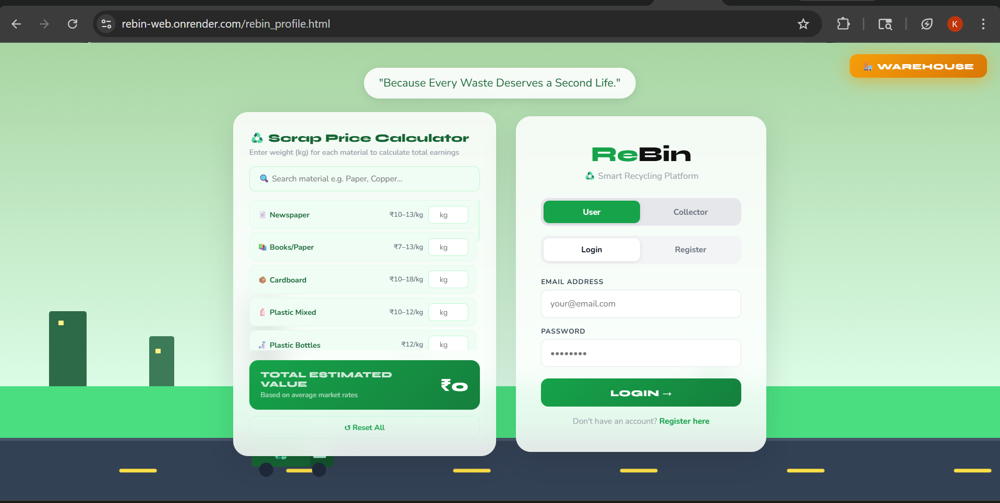

# ♻️ ReBin
🚀 It's Live! Check it out here : https://rebin-jq6q.onrender.com

**Schedule a recycling pickup, watch the collector arrive on a live map, and earn reward points for every kilogram you recycle.**

ReBin connects households that have recyclable waste with verified local collectors. A customer lists what they have, a nearby collector accepts the request, and the two meet through a secure one-time-code handshake. The collector weighs the waste and pays the customer, and the customer is rewarded with points that raise their level, rank them on a leaderboard and unlock rewards.



---

## How it works

1. **Request** – The customer adds items to a recycle cart (paper, plastic, metal, e-waste and more), chooses a time and a pickup location, and sees an instant estimate of what the waste is worth.
2. **Accept** – Verified collectors see open requests. The first collector to accept gets the job and the customer is notified immediately.
3. **Track** – The customer follows the collector on a live map with an estimated arrival time.
4. **Verify** – When the collector arrives, the customer reads out a one-time 6-digit code. The collector enters it to confirm they are at the right door.
5. **Weigh and pay** – The collector records the weight, the amount paid and a photo of the waste, and completes the pickup.
6. **Earn** – The customer receives 10 points per kg, moves up the levels from Eco Starter to Eco Legend, collects badges, climbs the leaderboard and redeems rewards.

## Features

### For customers
- Recycle cart with per-material rates and an instant earnings estimate
- Live collector tracking on a map
- Points, levels, badges, activity history and a public leaderboard
- Reward store
- Sign in with Google or email, and an editable profile with saved addresses
- Scrap price calculator right on the login page

### For collectors
- A dashboard of new requests and scheduled pickups
- OTP verification, weight entry and photo proof for every completed pickup
- Earnings, pickup history and ratings
- Account approval before any pickup can be accepted

### AI waste sorting
- Upload a photo of waste and a YOLO image-classification model identifies it as plastic, paper, metal, e-waste, cardboard or glass, with a "not sure" response when it isn't confident

## Built with trust and safety in mind

- **Verified handoff** – a random one-time code, hidden from the collector and locked after five wrong tries, proves the collector is really at the customer's door.
- **Fair rewards** – points and reward prices are calculated on the server, never in the browser, and a pickup can only be completed once.
- **No double bookings** – when two collectors tap Accept at the same moment, only one gets the pickup.
- **Private tracking** – live location is shared only between the customer and the collector assigned to that pickup.
- **Account safety** – hashed passwords, Google sign-in verified on the server, duplicate email, phone and username checks, and role-based access for customers and collectors.
- **Hardened by default** – input validation, upload limits, escaped output, rate limiting and security headers.

## Tech stack

| Layer | Technology |
|---|---|
| Frontend | HTML, CSS and vanilla JavaScript, fully responsive, Leaflet maps |
| Backend | Node.js, Express, Socket.IO for real-time updates |
| Database | MongoDB with Mongoose |
| Authentication | JWT, bcrypt, Google Identity Services |
| AI service | Python, Flask, Ultralytics YOLO (PyTorch) |

## Project structure

```
ReBin/
├── backend/
│   ├── index.js            Express server, real-time tracking, static hosting
│   ├── app.py              Flask + YOLO waste classifier
│   ├── routes/             auth, pickup, profile, leaderboard, contact
│   ├── models/             User, Collector, Pickup, Activity
│   ├── middleware/         Authentication and role checks
│   └── config/             Reward catalogue
├── frontend/               Customer, collector, leaderboard and warehouse pages
└── render.yaml             Deployment configuration
```

---

Built to make recycling rewarding. 🌍
